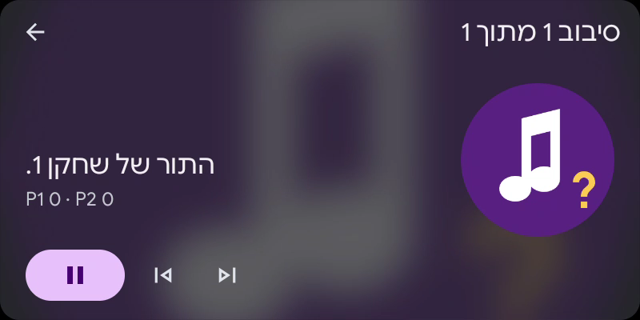
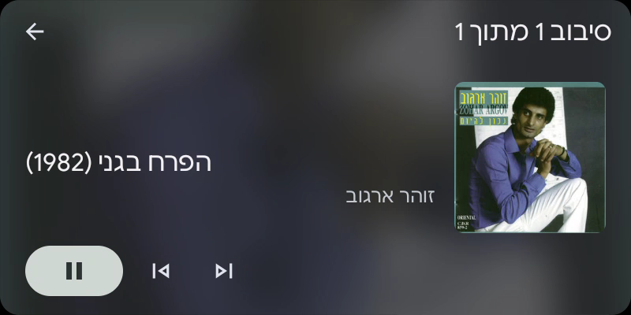
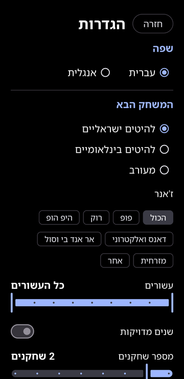

# RoadHit

A hands-free "guess the song" party game for the car and the phone. The app plays a short clip of
a well-known song, and each player in turn says its **title, artist and year** out loud. It runs on
Android Auto and on the phone, speaks and listens in **Hebrew or English**, and never shows the
song before the answer is judged.

<p>
  
  
</p>

<p>
  
  &nbsp;
  
</p>

## Features

- Voice-only play: setup, answers and scoring all happen by voice, so the driver never touches
  the screen.
- About 10,500 songs: Israeli and international hits from the 1950s to today, each with a
  playable Deezer preview.
- Choose Israeli, international or mixed songs, a genre, a range of decades or exact years, the
  number of players and the number of rounds.
- Answers are matched loosely: Hebrew or Latin spelling, small recognition errors, and a year
  that is close all count.

## Build and install

Requirements: the Android SDK (compileSdk 37), JDK 17 or later, and a phone with Android 13 or
later connected over USB with USB debugging on.

```sh
./gradlew :app:installDebug          # build and install
./gradlew :app:testDebugUnitTest     # unit tests
```

Open the app once on the phone and allow the **microphone**: the game listens for the answers.

## Android Auto

Android Auto hides sideloaded apps until you allow them:

1. On the phone, open Android Auto's settings (Settings → Apps → Android Auto → "Additional
   settings in the app").
2. Tap **Version** about ten times and accept "Allow development settings".
3. ⋮ → **Developer settings** → turn on **Unknown sources**.
4. Back in Android Auto's settings → **Customize launcher**, make sure RoadHit is ticked.

## Releasing

Pushing a version tag builds a signed APK on GitHub Actions and attaches it to a GitHub Release
(`.github/workflows/release.yml`). The signing key lives only in the repository's secrets.

One-time setup:

1. Create a signing key and **keep a backup of it outside GitHub**. Android installs an update
   only over an app signed with the same key; if the key is lost, users must uninstall and lose
   their saved game.
   ```sh
   keytool -genkeypair -v -keystore roadhit-release.jks -alias roadhit \
     -keyalg RSA -keysize 4096 -validity 10000
   ```
2. Add four repository secrets (Settings → Secrets and variables → Actions, or with `gh`):
   ```sh
   base64 -w0 roadhit-release.jks | gh secret set SIGNING_KEYSTORE_BASE64
   gh secret set SIGNING_STORE_PASSWORD
   gh secret set SIGNING_KEY_ALIAS        # roadhit
   gh secret set SIGNING_KEY_PASSWORD
   ```

Each release:

```sh
git tag v0.2 && git push origin v0.2     # tags look like v1.2 or v1.2.3
```

The version name is the tag without the `v`; the version code is `major×10000 + minor×100 + patch`,
so every newer tag installs over the older one. The release build is signed with a different key
than the debug build: uninstall a debug build before installing the first release.

## Song catalog

The song list ships as `app/src/main/assets/catalog.json`. A separate Python tool in
[`tools/catalog/`](tools/catalog/) builds it from Wikipedia charts, Deezer and MusicBrainz; see
[its README](tools/catalog/README.md).
